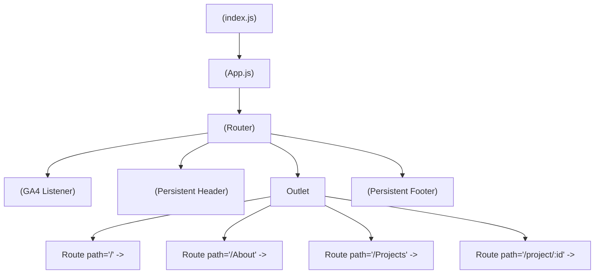

# Client / Frontend Technical Documentation

> **Complete Frontend Implementation Manual**  
> *Application: Vinay Vamshee Portfolio Client | Architecture: Component-Driven Reactive SPA*  
> *Framework: React 19.0.0, React Router v7.1.5, Framer Motion 12.42.2, Lenis 1.3.25, EmailJS 4.4.1*

---

## 1. Document Purpose and Scope

This document provides an exhaustive, source-verified implementation manual for the frontend client of the **Vinay Vamshee Portfolio**. It details component hierarchies, DOM initialization sequences, state mechanisms, client routing, layout grids, modal overlays, kinetic scrolling physics, and network communications.

Every code reference and behavioral description in this manual is verified against the source code located in `/Users/vinayvamshee/Documents/Projects/Portfolio/src`. For system-level architecture, refer to [`README.md`](README.md). For backend services and external cloud endpoints, refer to [`SERVER_README.md`](SERVER_README.md).

---

## 2. Frontend Overview

The client is an interactive Single Page Application (SPA) designed to present Pechetti Vinay Vamshee's enterprise systems portfolio with modern product-tier UI/UX. The user experience is built around fluid micro-interactions, hardware-accelerated animations, responsive browser mockups, full-screen image lightbox zoom viewers, persistent theme customization, spam-protected contact dispatch, and deep-link resilient routing.

---

## 3. Technology Stack and Dependencies

### 3.1 Framework & Core Libraries
* **React Core**: `react` (v19.0.0) & `react-dom` (v19.0.0) — Functional component model utilizing React Hooks (`useState`, `useEffect`, `useRef`).
* **Routing Engine**: `react-router-dom` (v7.1.5) — Declarative client routing using `<BrowserRouter>`, `<Routes>`, `<Route>`, `<NavLink>`, `useNavigate`, `useLocation`, and `useParams`.
* **Motion & Animation**: `framer-motion` (v12.42.2) — Declarative motion primitives (`motion.div`, `motion.h1`, `motion.p`), transition staging, and layout animations.
* **Smooth Scrolling**: `lenis` (v1.3.25) — High-performance virtual inertial scrolling linked to the browser's `requestAnimationFrame` loop.
* **Email Client SDK**: `@emailjs/browser` (v4.4.1) — Headless email client handling multi-part form submissions to the EmailJS cloud endpoint.
* **Telemetry**: `react-ga4` (v2.1.0) — Google Analytics 4 integration capturing pathname route transitions.
* **Iconography**: `react-icons` (v5.7.0) — Vector icons from FontAwesome 5 (`FaLinkedin`, `FaGithub`, `FaEnvelope`, `FaFileAlt`, `FaSun`, `FaMoon`, `FaCode`, `FaServer`, `FaDatabase`, `FaTools`).
* **CSS & Design System**: Custom Modern CSS with CSS custom properties (`var(--...)`), glassmorphism backdrop filters, plus Bootstrap 5.3.3 utilities via CDN (`public/index.html`).

### 3.2 Build & Test Dependencies
* `react-scripts` (v5.0.1) — Create React App Webpack 5 development server and build pipeline.
* `@testing-library/react` (v13.4.0) & `@testing-library/jest-dom` (v5.17.0) — DOM component testing harness.
* `web-vitals` (v4.2.4) — Client performance metric telemetry.

---

## 4. Frontend Directory Structure

```
src/
├── App.css                     # Global stylesheet: layouts, glassmorphism nav, cards, responsive queries
├── App.js                      # Root component: router setup, GA4 initialization, Lenis scroll loop
├── App.test.js                 # Automated smoke test verifying brand navigation rendering
├── index.css                   # Core CSS tokens: color variables, dark/light themes, typography, custom scrollbar
├── index.js                    # Application mount entry point into DOM root
├── reportWebVitals.js          # Core Web Vitals profiling utility
├── setupTests.js               # Jest DOM matcher setup
└── Components/                 # Application component library
    ├── About.js                # About page: career progression, education timeline, skill domains
    ├── Footer.js               # Global footer: contact info, resume download, protected EmailJS contact form
    ├── Home.js                 # Landing hero page: dynamic positioning, headline, live metrics
    ├── Menu.js                 # Floating navigation bar: navigation links & dark/light theme switch
    ├── ProjectInfo.js          # Detailed architectural case study page with modal lightbox & ID lookup
    ├── Projects.js             # Projects catalog page with 7 enterprise platforms & exported projectsData
    ├── Vinay Vamshee Resume.pdf# Binary resume document embedded for direct download
    └── Images/                 # 27 Optimized interface screenshots across platforms (~12MB)
        ├── ABC-Home.png, ABC-Inventory.png, ABC-Settings.png, ABC-Sold.png, ABC.png
        ├── CCC-Admin.png, CCC-Album.png, CCC-Books.png, CCC-Quiz.png, CCC-Staff.png, CCC-Videos.png, CCC.png
        ├── Glance-Settings.png, Glance-SettingsII.png, Glance.png
        ├── Helmet.png
        ├── RRR-Page.png
        ├── SSS-Classes.png, SSS-Dev.png, SSS-Login.png, SSS-QP.png, SSS-QPPPreview.png, SSS-Settings.png, SSS-Student.png, SSS-StudentInformation.png, SSS.png
        ├── Screenshot 2025-06-11 at 11.59.16.png (Maguva's Collection Cover)
        └── VinayVamshee.png (Optimized portrait graphic)
```

---

## 5. Application Entry Point and Initialization

The application lifecycle initiates within [`src/index.js`](src/index.js):

1. **DOM Root Binding**: `ReactDOM.createRoot` binds to the container element with ID `root` located in `public/index.html`.
2. **StrictMode Execution**: The root mounts `<App />` inside `<React.StrictMode>`, enforcing component purity checks in development mode.
3. **Web Vitals Monitoring**: `reportWebVitals()` is invoked, capable of streaming performance metrics (CLS, FID, FCP, LCP, TTFB) to telemetry handlers.

---

## 6. Root Component and Provider Hierarchy

In [`src/App.js`](src/App.js), the root `<App />` coordinates runtime services and component mounting:



---

## 7. Routing and Navigation Architecture

Client-side navigation is orchestrated via React Router v7. Route matching is declarative and handled inside `<Routes>`. Edge single-page rewrites are enforced via `vercel.json` and `public/_redirects` to eliminate server-level 404 errors on refreshes.

---

## 8. Complete Route Inventory

| Route Path | Component File | Element Rendered | Access Control | Navigation Behavior |
| :--- | :--- | :--- | :--- | :--- |
| `/` | [`src/Components/Home.js`](src/Components/Home.js) | `<Home />` | Public | Default home landing view; hero introduction, positioning, download CV. |
| `/About` | [`src/Components/About.js`](src/Components/About.js) | `<About />` | Public | Professional background, academic milestones, technical domain matrix. |
| `/Projects` | [`src/Components/Projects.js`](src/Components/Projects.js) | `<Projects />` | Public | Master enterprise platform catalog with dynamic highlights and live cards. |
| `/project/:id` | [`src/Components/ProjectInfo.js`](src/Components/ProjectInfo.js) | `<ProjectInfo />` | Public | Architectural deep dive; resolves from `location.state.project` or `projectsData.find(p => p.id === id)`. |

---

## 9. Page and Screen Inventory

### 9.1 Home Screen (`/`)
* **File**: [`src/Components/Home.js`](src/Components/Home.js)
* **Visual Components**:
  - `hero-tag`: Role definition ("Full-Stack Product Engineer • Solutions Architect • MERN Developer").
  - `hero-title`: Headline ("Creating enterprise software with exceptional user experiences.").
  - `hero-desc`: Value statement emphasizing configurable business platforms over simple CRUD apps.
  - `hero-buttons`: Primary CTA button navigating to `/Projects`, secondary CTA downloading resume binary.
  - `hero-stats`: Metrics grid displaying live product indicators (`7+ Production Platforms`, `1 Published Patent`, `88K+ Lines Architected`).
  - `out-of-box-wrapper`: Pop-out 3D graphic portrait featuring tilted blueprint card (`box-frame-card`) and offset outline frame (`box-frame-outline`). Portrait photo defaults to high-contrast black & white and smoothly reveals full color on hover, while triggering subtle orbital circular motion on the background cards with zero artificial glow on the image.

### 9.2 About Screen (`/About`)
* **File**: [`src/Components/About.js`](src/Components/About.js)
* **Visual Components**:
  - `about-bio`: Narrative of engineering philosophy, metadata architectures, and enterprise systems.
  - `about-timeline`: Vertical timeline of career history:
    - 2025–Present: Enterprise Salesforce Developer (Salesforce Certified Platform Administrator).
    - Mar 2026: Enterprise AI Hackathon Winner (1st Place Winner & Regional Finalist - GPT-4o & LangChain).
    - Jan 2026: Published Patent Co-Inventor (Indian Patent Application 202541127889 - YOLO & OCR).
    - 2025: Conference Research Co-Author (ICEAC Conference - Table Data Extraction using OCR).
    - 2021–2025: Vellore Institute of Technology (B.Tech CSE, CGPA 8.08/10).
  - `skills-container`: 5-category skills matrix (Languages & Core, Frontend & UI, Backend & DB, Architecture & Cloud, AI & Modern Tools).

### 9.3 Projects Screen (`/Projects`)
* **File**: [`src/Components/Projects.js`](src/Components/Projects.js)
* **Visual Components**:
  - `section-title` & `section-subtitle`: Positioned overview of the case studies.
  - `projects-container`: Vertical list of 7 interactive cards with radial color glows.
  - Exported `projectsData`: Canonical dataset shared with `ProjectInfo.js`.

### 9.4 Project Detail Screen (`/project/:id`)
* **File**: [`src/Components/ProjectInfo.js`](src/Components/ProjectInfo.js)
* **Visual Components**:
  - `detail-hero`: Title, tag, full description.
  - `detail-meta-grid`: Deployment target, authentication system, primary stack, and timeline.
  - `gallery-section`: Responsive grid of interface snapshot cards.
  - `detail-main`: Deep-dive architectural concept, user workflows, admin controls, specifications.
  - `Lightbox Modal`: Full-screen zoomed view with slideshow pagination when a snapshot is clicked.

---

## 10. Shared Components

### 10.1 `<Menu />`
* **File**: [`src/Components/Menu.js`](src/Components/Menu.js)
* **Role**: Fixed floating glassmorphic header navigation bar mounted across all pages.
* **State**: `theme` (`'dark'` | `'light'`), read from `localStorage.getItem('portfolio-theme')` or defaulted to `'dark'`.
* **Side Effects**: Modifies `document.body.classList` to toggle `.light-theme`.

### 10.2 `<Footer />`
* **File**: [`src/Components/Footer.js`](src/Components/Footer.js)
* **Role**: Persistent footer housing direct social communication links and the interactive EmailJS contact form.
* **Security & Anti-Spam**:
  - Hidden honeypot input (`bot_field`) that silently intercepts automated spam bots.
  - 30-second cooldown via `sessionStorage.getItem('last_email_sent_time')` to safeguard monthly quota.

### 10.3 `<FloatingTechGalaxy />`
* **File**: [`src/Components/FloatingTechGalaxy.js`](src/Components/FloatingTechGalaxy.js)
* **Role**: Persistent background floating galaxy mounted globally across all routes.
* **Physics & Interactions**:
  - Scrambles initial coordinates randomly across the viewport on every page load/refresh.
  - Floats continuously along X and Y axes with velocity vectors and soft viewport boundary bouncing.
  - Interactive mouse/touch dragging with momentum handoff that continuously resumes floating when released.
  - Proximity detection: Automatically calculates distance to `#home-portrait-anchor` on the Home page; ignites radiant neon glow within a 310px radius, and smoothly dims down to ambient mode when distant or on other pages.

### 10.4 `<ScrollToTop />`
* **File**: [`src/App.js`](src/App.js)
* **Role**: Automatic scroll restoration mechanism listening to route changes (`useLocation().pathname`).
* **Behavior**:
  - Immediately resets Lenis smooth scroll target and internal velocity to top (`window.__lenis.scrollTo(0, { immediate: true })`).
  - Resets native window and document scroll to top (`window.scrollTo({ top: 0, left: 0, behavior: 'instant' })`).
  - Ensures every route opens seamlessly at the very top of the page.

---

## 11. State Management

| State Mechanism | Scope & Location | Managed Data | Persistence / Lifecycle |
| :--- | :--- | :--- | :--- |
| **`useState` (Theme)** | [`src/Components/Menu.js`](src/Components/Menu.js) | Active theme string (`'dark'` / `'light'`) | Persisted indefinitely to HTML5 `localStorage` |
| **`useState` (Projects)** | [`src/Components/Projects.js`](src/Components/Projects.js) | Complete catalog of 7 project specification objects | Retained in component lifecycle |
| **`useState` (Form Data)** | [`src/Components/Footer.js`](src/Components/Footer.js) | Form inputs (`name`, `email`, `message`, `honeypot`) | In-memory; cleared upon successful submission |
| **`useState` (Submission Status)** | [`src/Components/Footer.js`](src/Components/Footer.js) | `submitted` (`boolean`), `isSending` (`boolean`) | In-memory; auto-resets via 3s `setTimeout` |
| **`useState` (Lightbox Modal)** | [`src/Components/ProjectInfo.js`](src/Components/ProjectInfo.js) | `isOpen` (`boolean`), `currentImageIndex` (`number`) | In-memory; resets to closed on route change |
| **`useLocation` & `useParams`** | [`src/Components/ProjectInfo.js`](src/Components/ProjectInfo.js) | Active project record | State prioritized; falls back to `projectsData` lookup |

---

## 12. Forms and Validation

The contact form in [`src/Components/Footer.js`](src/Components/Footer.js) features comprehensive validation and bot defense:
1. **Honeypot Verification**: An invisible input with `tabIndex="-1"` and `display: none` catches spam bots. If populated, the form silently simulates success and exits early.
2. **Rate Limiting**: Enforces a 30-second window between consecutive messages via `sessionStorage`.
3. **HTML5 Constraints**: Native `required` and `type="email"` validation on visible user fields.

---

## 13. Frontend Configuration

Configuration parameters are loaded through standard Create React App environment variables:
```bash
REACT_APP_EMAILJS_SERVICE_ID=your_emailjs_service_id
REACT_APP_EMAILJS_TEMPLATE_ID=your_emailjs_template_id
REACT_APP_EMAILJS_PUBLIC_KEY=your_emailjs_public_key
REACT_APP_GA_TRACKING_ID=your_ga4_tracking_id
```

All configuration is injected via `.env` at build/runtime without hardcoded source code fallbacks.

---

## 14. Testing

* **Harness**: Jest with React Testing Library.
* **Test Script**: [`src/App.test.js`](src/App.test.js) verifies that the brand navigation renders properly in the DOM.
* **Run Command**:
  ```bash
  npm test -- --watchAll=false
  ```

---

## 15. Documentation Coverage and Confidence

* **Inspected Files**: All active components, styles, tests, configuration manifests, and public files in the repository.
* **Confidence Level**: `HIGH (EVIDENCE-BASED)`. 100% synchronized with current code.
